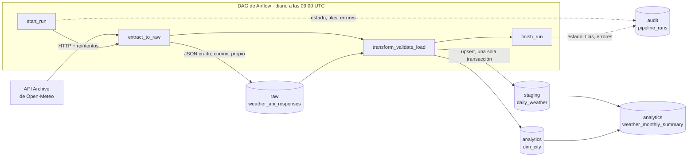

# Weather ETL Pipeline

[](https://github.com/SagariusJ/weather-etl-pipeline/actions/workflows/ci.yml)


**[Read in English](README.md)**

Pipeline ETL batch con prácticas de producción: extrae datos climáticos diarios de 8 ciudades de Latinoamérica desde la [API de Open-Meteo](https://open-meteo.com/), los valida con controles de calidad y los carga de forma **idempotente** en un warehouse PostgreSQL por capas. Está orquestado con Apache Airflow, corre completo en Docker y se prueba en CI contra una base de datos real.

## El problema

Una empresa de logística o agricultura que opera en varias ciudades de Latinoamérica necesita **datos climáticos diarios confiables y actualizados** para planificar operaciones y analizar tendencias. Los datos deben llegar todos los días sin que nadie ejecute scripts a mano, los datos malos nunca deben llegar a los analistas, y cualquier falla debe ser visible y recuperable.

## Arquitectura



Cada corrida diaria procesa **el día anterior**: la corrida del 15 de octubre a las 09:00 UTC carga el 14, que ya terminó en la zona horaria de todas las ciudades.


## Decisiones de diseño

| Decisión | Por qué |
|---|---|
| **Primero la capa raw**: la respuesta de la API se guarda en `raw` *antes* de transformar | Si la validación falla, la respuesta exacta queda guardada para investigar. Staging se puede reconstruir desde `raw` tras corregir un bug, sin volver a llamar a la API. Además es el punto de entrega entre tareas de Airflow, así que no viajan datos grandes por XCom. |
| **Upsert idempotente**: `INSERT ... ON CONFLICT (city_id, weather_date) DO UPDATE ... WHERE ... IS DISTINCT FROM` | Ejecutar el mismo día una o diez veces da el mismo resultado. Solo se actualizan las filas en que algún valor cambió de verdad (Open-Meteo corrige los datos recientes), así que `updated_at` marca correcciones reales. `RETURNING (xmax = 0)` distingue filas insertadas, actualizadas y sin cambios. |
| **Dos niveles de reintentos** | Dentro del código, backoff exponencial (1 s, 2 s, 4 s) para cortes de red breves en una ciudad. En Airflow, reintentos de la tarea (5 y 10 min) para caídas más largas. Los errores HTTP 4xx fallan de inmediato, porque reintentar una petición mal hecha no sirve. |
| **Calidad de datos: errores y advertencias** | Los valores imposibles o los datos críticos faltantes detienen el pipeline *antes* de cargar. Los datos no críticos faltantes (viento, código de clima) solo generan una advertencia en el log. Todos los errores se reportan juntos. |
| **Transacciones** | `dim_city` y `staging` se escriben en una sola transacción: se actualizan las dos o ninguna. |
| **Tabla de auditoría** | Cada corrida registra estado, filas extraídas y cargadas, duración y mensaje de error. Se consulta con SQL en vez de revisar logs. |
| **La lógica vive en `src/`, no en el DAG** | El DAG solo orquesta. Cada módulo es Python normal y se puede testear sin Airflow. |

## Modelo de datos

| Esquema | Tabla | Descripción |
|---|---|---|
| `raw` | `weather_api_responses` | JSON de la API sin modificar (`JSONB`), append-only: historial completo de extracciones |
| `staging` | `daily_weather` | Filas limpias, tipadas y validadas. Una por ciudad y día. PK `(city_id, weather_date)` |
| `analytics` | `dim_city` | Dimensión de ciudades, sincronizada desde [`config/cities.yaml`](config/cities.yaml) |
| `analytics` | `weather_monthly_summary` | Vista: promedios, extremos y días de lluvia por ciudad y mes |
| `audit` | `pipeline_runs` | Una fila por corrida del DAG: estado, filas, duración, error |

## Controles de calidad

| Control | Nivel |
|---|---|
| Esquema: columnas y tipos esperados | Error (detiene los demás controles) |
| Resultado no vacío, todas las ciudades configuradas, fecha correcta | Error |
| Sin nulos en la clave ni en campos críticos (ciudad, fecha, temperatura máxima/mínima, precipitación) | Error |
| Sin duplicados de `(city_id, weather_date)` | Error |
| Rangos físicamente posibles (por ejemplo, −90 a 60 °C, precipitación ≥ 0) | Error |
| Consistencia: temperatura `mínima ≤ media ≤ máxima` | Error |
| Códigos de clima WMO válidos | Error |
| Unidades esperadas de la API (°C, mm, km/h), revisadas en transform | Error |
| Nulos en campos opcionales (temperatura media, viento, código de clima) | Advertencia |

## Consultas de ejemplo

Resumen mensual de octubre de 2026 (19 días cargados):

```sql
SELECT city_name, days_observed, avg_temp_max_c, avg_temp_min_c, total_precipitation_mm, rainy_days
FROM analytics.weather_monthly_summary
ORDER BY total_precipitation_mm DESC;
```

```
    city_name     | days_observed | avg_temp_max_c | avg_temp_min_c | total_precipitation_mm | rainy_days
------------------+---------------+----------------+----------------+------------------------+------------
 Ciudad de México |            19 |           21.8 |           13.6 |                  215.4 |         17
 São Paulo        |            19 |           25.2 |           16.7 |                  146.9 |         17
 Quito            |            19 |           18.6 |            9.6 |                  146.7 |         18
 Santiago         |            19 |           19.8 |           10.6 |                  112.7 |          8
 Montevideo       |            19 |           14.7 |           12.5 |                   84.1 |         11
 Bogotá           |            19 |           20.8 |           11.3 |                   78.5 |         17
 Buenos Aires     |            19 |           17.4 |           11.2 |                   58.9 |          9
 Lima             |            19 |           24.9 |           20.6 |                    1.0 |          0
```

Mayores amplitudes térmicas diarias:

```sql
SELECT c.city_name, w.weather_date, w.temperature_max_c, w.temperature_min_c,
       w.temperature_max_c - w.temperature_min_c AS daily_range_c
FROM staging.daily_weather w
JOIN analytics.dim_city c USING (city_id)
ORDER BY daily_range_c DESC
LIMIT 5;
```

```
 city_name | weather_date | temperature_max_c | temperature_min_c | daily_range_c
-----------+--------------+-------------------+-------------------+---------------
 Santiago  | 2026-10-01   |             26.20 |             11.60 |         14.60
 São Paulo | 2026-10-08   |             30.00 |             15.90 |         14.10
 Bogotá    | 2026-10-05   |             23.00 |              9.30 |         13.70
 Santiago  | 2026-10-10   |             21.90 |              8.40 |         13.50
 São Paulo | 2026-10-09   |             32.20 |             18.90 |         13.30
```

Salud del pipeline según la tabla de auditoría:

```sql
SELECT count(*) AS runs,
       count(*) FILTER (WHERE status = 'success') AS ok,
       sum(rows_loaded) AS rows_loaded,
       round(avg(extract(epoch FROM finished_at - started_at)), 1) AS avg_seconds
FROM audit.pipeline_runs;
```

```
 runs | ok | rows_loaded | avg_seconds
------+----+-------------+-------------
   19 | 19 |         144 |        13.5
```

Las 19 corridas cargaron 144 filas, no 152 (19 días × 8 ciudades). El 13 de octubre ya se había cargado a mano durante el desarrollo, así que su corrida del DAG encontró 8 filas idénticas y no cambió nada: la idempotencia en la práctica.

## Cómo ejecutarlo

**Requisitos:** [Docker Desktop](https://www.docker.com/products/docker-desktop/) (con al menos 4 GB de RAM asignados) y [uv](https://docs.astral.sh/uv/).

```bash
git clone https://github.com/SagariusJ/weather-etl-pipeline.git
cd weather-etl-pipeline

# 1. Variables de entorno: copia la plantilla y completa las claves
cp .env.example .env

# 2. Levantar el stack (Airflow + warehouse PostgreSQL)
docker compose up -d
```

3. Abre Airflow en <http://localhost:8080> (usuario y clave: `AIRFLOW_ADMIN_*` del `.env`).
4. Ejecuta `warehouse_healthcheck` para validar la instalación y luego activa `weather_etl`.
5. Carga días pasados con un backfill. Por ejemplo, del 1 al 7 de octubre (corridas del 2 al 8, porque cada una carga el día anterior):

```bash
docker compose exec airflow-scheduler airflow backfill create --dag-id weather_etl --from-date 2026-10-02 --to-date 2026-10-08T09:00
```

El warehouse queda disponible en `localhost:15432` (credenciales `WAREHOUSE_*` del `.env`):

```bash
docker compose exec -T warehouse-db psql -U weather -d weather -c "SELECT * FROM analytics.weather_monthly_summary"
```

## Desarrollo

```bash
uv sync                                  # .venv con las mismas versiones que la imagen de Airflow
uv run ruff format . && uv run ruff check .
uv run pytest                            # 40 tests unitarios (se saltan los de integración)
uv run --env-file .env pytest            # los 45 tests, incluida la integración con PostgreSQL
```

Los tests de integración usan una base separada (`TEST_WAREHOUSE_DB`), que debe terminar en `_test`: la fixture rechaza cualquier otra, porque los tests vacían tablas. Se crea una vez con:

```bash
docker compose exec warehouse-db createdb -U weather weather_test
```

**CI:** cada push ejecuta [GitHub Actions](.github/workflows/ci.yml): linter, revisión de formato y todos los tests, con un PostgreSQL temporal para los de integración.

| Archivo de tests | Qué cubre |
|---|---|
| `test_extract.py` | Reintentos, sin reintento ante 4xx, timeout, abandono tras N intentos. La API se simula, no necesita red |
| `test_transform.py` | Listas paralelas a filas, tipos de columna, unidades, campos faltantes |
| `test_validate.py` | Cada regla de calidad detecta su problema; las advertencias no fallan |
| `test_load.py` | Conversión de nulos y tipos NumPy; **contra PostgreSQL real**: upsert idempotente, detección de cambios, ida y vuelta por raw, rollback de transacciones |

## Estructura

```
weather-etl-pipeline/
├── .github/workflows/ci.yml   # CI: linter + tests con un servicio PostgreSQL
├── config/cities.yaml         # ciudades a procesar (se agregan aquí, sin tocar código)
├── dags/
│   ├── etl_dag.py             # DAG principal: start → extract → transform/validate/load → finish
│   └── healthcheck_dag.py     # valida la conexión al warehouse y los imports
├── sql/init/01_schemas.sql    # DDL del warehouse (se aplica al crear el contenedor)
├── src/weather_etl/
│   ├── extract.py             # llamadas a la API con timeout y backoff exponencial
│   ├── transform.py           # JSON → DataFrame tipado, revisión de unidades
│   ├── validate.py            # reglas de calidad (errores y advertencias)
│   ├── load.py                # inserción en raw, upserts idempotentes, transacciones
│   └── audit.py               # registro de corridas en audit.pipeline_runs
├── tests/                     # 45 tests (unitarios + integración)
├── docker-compose.yml         # Airflow 3.3 (LocalExecutor) + 2 instancias de PostgreSQL
└── pyproject.toml             # dependencias fijadas a las versiones de la imagen de Airflow
```

## Lecciones aprendidas

Problemas reales que aparecieron al construirlo y cómo se resolvieron:

- **`PostgresHook.get_conn()` devuelve una conexión de psycopg 3** en esta versión de Airflow, pero el código de carga usa psycopg2. En psycopg2, `with conn:` significa *commit*; en psycopg 3, *cierra* la conexión. El DAG arma una conexión psycopg2 con las credenciales de la conexión de Airflow.
- **Windows/Hyper-V reserva rangos de puertos sin avisar** (aquí 5258–5757) al reiniciar, y Docker dejó de poder publicar el warehouse en el 5433. Ahora el puerto se configura en `.env` y por defecto es 15432.
- **Casos borde de Airflow:** una corrida con fecha lógica anterior al `start_date` del DAG no crea tareas y se marca como *success*; las corridas con fecha lógica futura nunca empiezan; y `backfill --to-date` excluye ese día si no se indica la hora.
- **Los tipos no deben depender de los datos:** si la API devuelve `10` en vez de `10.0`, pandas crea una columna de enteros. Las columnas se convierten explícitamente para que el esquema sea el mismo todos los días, y hay un test que lo verifica.

## Mejoras posibles

- **Ventana de reprocesamiento:** reprocesar los últimos N días en cada corrida para incorporar automáticamente las correcciones de Open-Meteo (el upsert ya lo soporta).
- **Alertas:** enviar las fallas a Slack o por email desde el `on_failure_callback`.
- **dbt** para la capa analytics, con tests y documentación de linaje generada.
- **Despliegue en la nube:** Airflow administrado (MWAA o Cloud Composer) y un warehouse en la nube.

## Fuente de datos

Datos climáticos de [Open-Meteo.com](https://open-meteo.com/) (API histórica, datos de reanálisis ERA5 y modelos), bajo licencia [CC BY 4.0](https://creativecommons.org/licenses/by/4.0/).
