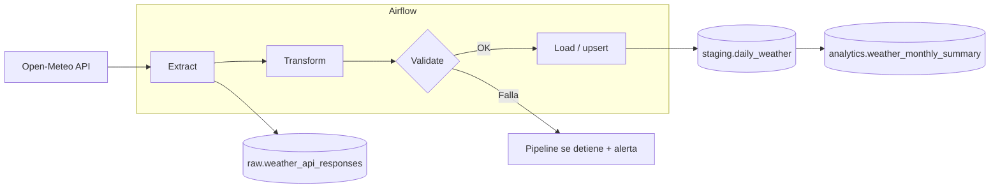

# Weather ETL Pipeline

Pipeline ETL diario que extrae datos climáticos de la API de [Open-Meteo](https://open-meteo.com/), los valida y los carga de forma idempotente en un data warehouse PostgreSQL, orquestado con Apache Airflow.

> 🚧 En construcción

## Problema

Una empresa de logística o agricultura que opera en varias ciudades de Latinoamérica necesita datos climáticos diarios **confiables y actualizados automáticamente** para planificar operaciones y analizar tendencias, sin que nadie ejecute scripts a mano.

## Arquitectura



## Stack

Python 3.12 · SQL · PostgreSQL 17 · Apache Airflow 3.3 · Docker Compose · pytest · Ruff · uv

## Modelo de datos

| Esquema | Tabla | Descripción |
|---|---|---|
| `raw` | `weather_api_responses` | Respuesta JSON cruda de la API (append-only) |
| `staging` | `daily_weather` | Una fila por ciudad y día. PK `(city_id, weather_date)` |
| `analytics` | `dim_city` | Ciudades procesadas (desde `config/cities.yaml`) |
| `analytics` | `weather_monthly_summary` | Vista: promedios, extremos y días de lluvia por mes |
| `audit` | `pipeline_runs` | Una fila por ejecución: estado, filas, duración, error |

## Cómo ejecutarlo

Requisitos: Docker Desktop (con al menos 4 GB de RAM asignados) y [uv](https://docs.astral.sh/uv/).

```bash
# 1. Variables de entorno
cp .env.example .env        # y completa las claves (ver comentarios en el archivo)

# 2. Levantar el stack
docker compose up -d

# 3. Abrir Airflow en http://localhost:8080 (usuario/clave: los de AIRFLOW_ADMIN_* en .env)
#    y ejecutar el DAG `warehouse_healthcheck` para validar la instalación.
```

El warehouse queda disponible en `localhost:5433` (credenciales `WAREHOUSE_*` del `.env`).

### Desarrollo local

```bash
uv sync                # crea .venv con las mismas versiones que la imagen de Airflow
uv run pytest          # tests
uv run ruff check .    # linter
```

## Estructura

```
weather-etl-pipeline/
├── config/cities.yaml       # ciudades a procesar
├── dags/                    # DAGs de Airflow
├── sql/init/                # DDL del warehouse (se aplica al crear el contenedor)
├── src/weather_etl/         # lógica del pipeline (independiente de Airflow, testeable)
│   ├── extract.py
│   ├── transform.py
│   ├── validate.py
│   └── load.py
├── tests/
├── docker-compose.yml
└── pyproject.toml
```
