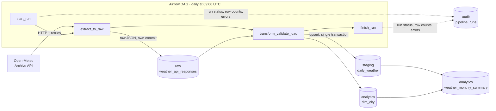
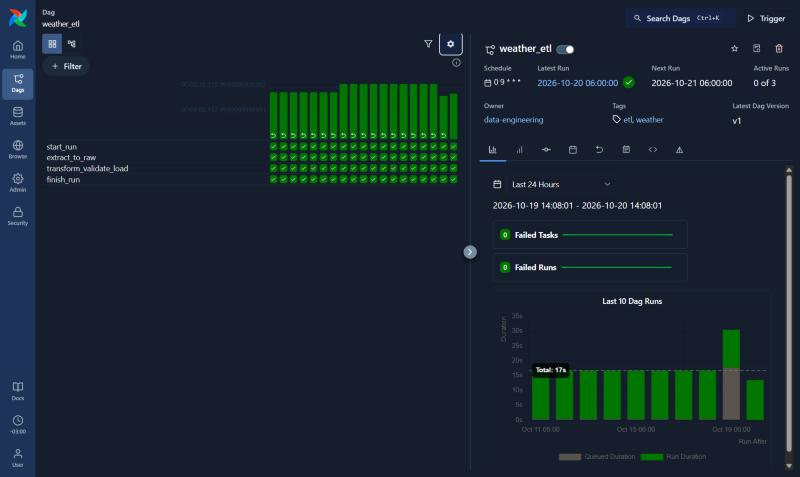

# Weather ETL Pipeline

[](https://github.com/SagariusJ/weather-etl-pipeline/actions/workflows/ci.yml)


**[Leer en español](README.es.md)**

A production-style batch ETL pipeline that extracts daily weather data for 8 Latin American cities from the [Open-Meteo API](https://open-meteo.com/), validates it with data quality checks, and loads it **idempotently** into a layered PostgreSQL warehouse — orchestrated by Apache Airflow, fully containerized, and tested in CI against a real database.

## The problem

A logistics or agriculture company operating across Latin America needs **reliable, up-to-date daily weather data** for the cities where it operates, to plan operations and analyze trends. The data must arrive every day without anyone running scripts by hand, bad data must never reach analysts, and any failure must be visible and recoverable.

## Architecture



Each daily run processes **the previous day** (the 09:00 UTC run on Oct 15 loads Oct 14, which has already ended in every city's timezone).



## Key design decisions

| Decision | Why |
|---|---|
| **Raw layer first** — the API response is committed to `raw` *before* transforming | If validation fails, the exact payload is preserved for debugging. Staging can be rebuilt from `raw` after a bug fix without calling the API again. It is also the hand-off between Airflow tasks, so no large data travels through XCom. |
| **Idempotent upsert** — `INSERT ... ON CONFLICT (city_id, weather_date) DO UPDATE ... WHERE ... IS DISTINCT FROM` | Running the same day once or ten times yields the same result. Rows are only updated when a value actually changed (Open-Meteo revises recent data), so `updated_at` marks real corrections. `RETURNING (xmax = 0)` reports inserted vs. updated vs. unchanged rows. |
| **Two layers of retries** | In-code exponential backoff (1s, 2s, 4s) handles network blips for a single city; Airflow task retries (5 min, 10 min) handle longer outages. HTTP 4xx errors fail immediately — retrying a bad request is pointless. |
| **Data quality: errors vs. warnings** | Impossible or missing critical values stop the pipeline *before* loading. Missing non-critical fields (wind, weather code) only log a warning. All errors are collected and reported together. |
| **Transactions** | `dim_city` and `staging` are written in one transaction: either both are updated or neither is. |
| **Audit table** | Every run records status, rows extracted/loaded, duration and error message — queryable with SQL instead of digging through logs. |
| **Pipeline logic lives in `src/`, not in the DAG** | The DAG only orchestrates. Every module is plain Python, testable without Airflow. |

## Data model

| Schema | Table | Description |
|---|---|---|
| `raw` | `weather_api_responses` | Untouched API JSON (`JSONB`), append-only — full extraction history |
| `staging` | `daily_weather` | Clean, typed, validated rows. One per city and day. PK `(city_id, weather_date)` |
| `analytics` | `dim_city` | City dimension, synced from [`config/cities.yaml`](config/cities.yaml) |
| `analytics` | `weather_monthly_summary` | View: monthly averages, extremes and rainy days per city |
| `audit` | `pipeline_runs` | One row per DAG run: status, row counts, duration, error |

## Data quality checks

| Check | Level |
|---|---|
| Schema: expected columns and types | Error (stops other checks) |
| Non-empty result, all configured cities present, correct date | Error |
| No nulls in key and critical fields (city, date, max/min temperature, precipitation) | Error |
| No duplicate `(city_id, weather_date)` | Error |
| Physically possible ranges (e.g. −90 to 60 °C, precipitation ≥ 0) | Error |
| Consistency: `min ≤ mean ≤ max` temperature | Error |
| Valid WMO weather codes | Error |
| Expected units from the API (°C, mm, km/h) — checked during transform | Error |
| Nulls in optional fields (mean temperature, wind, weather code) | Warning |

## Example queries

Monthly summary for October 2026 (19 days loaded):

```sql
SELECT city_name, days_observed, avg_temp_max_c, avg_temp_min_c, total_precipitation_mm, rainy_days
FROM analytics.weather_monthly_summary
ORDER BY total_precipitation_mm DESC;
```

```
    city_name     | days_observed | avg_temp_max_c | avg_temp_min_c | total_precipitation_mm | rainy_days
------------------+---------------+----------------+----------------+------------------------+------------
 Ciudad de México |            19 |           21.8 |           13.6 |                  215.4 |         17
 São Paulo        |            19 |           25.2 |           16.7 |                  146.9 |         17
 Quito            |            19 |           18.6 |            9.6 |                  146.7 |         18
 Santiago         |            19 |           19.8 |           10.6 |                  112.7 |          8
 Montevideo       |            19 |           14.7 |           12.5 |                   84.1 |         11
 Bogotá           |            19 |           20.8 |           11.3 |                   78.5 |         17
 Buenos Aires     |            19 |           17.4 |           11.2 |                   58.9 |          9
 Lima             |            19 |           24.9 |           20.6 |                    1.0 |          0
```

Largest daily temperature swings:

```sql
SELECT c.city_name, w.weather_date, w.temperature_max_c, w.temperature_min_c,
       w.temperature_max_c - w.temperature_min_c AS daily_range_c
FROM staging.daily_weather w
JOIN analytics.dim_city c USING (city_id)
ORDER BY daily_range_c DESC
LIMIT 5;
```

```
 city_name | weather_date | temperature_max_c | temperature_min_c | daily_range_c
-----------+--------------+-------------------+-------------------+---------------
 Santiago  | 2026-10-01   |             26.20 |             11.60 |         14.60
 São Paulo | 2026-10-08   |             30.00 |             15.90 |         14.10
 Bogotá    | 2026-10-05   |             23.00 |              9.30 |         13.70
 Santiago  | 2026-10-10   |             21.90 |              8.40 |         13.50
 São Paulo | 2026-10-09   |             32.20 |             18.90 |         13.30
```

Pipeline health from the audit table:

```sql
SELECT count(*) AS runs,
       count(*) FILTER (WHERE status = 'success') AS ok,
       sum(rows_loaded) AS rows_loaded,
       round(avg(extract(epoch FROM finished_at - started_at)), 1) AS avg_seconds
FROM audit.pipeline_runs;
```

```
 runs | ok | rows_loaded | avg_seconds
------+----+-------------+-------------
   19 | 19 |         144 |        13.5
```

19 runs loaded 144 rows, not 152 (19 days × 8 cities): Oct 13 had already been loaded manually during development, so its DAG run found 8 identical rows and changed nothing — idempotency in practice.

## Getting started

**Requirements:** [Docker Desktop](https://www.docker.com/products/docker-desktop/) (≥ 4 GB RAM assigned) and [uv](https://docs.astral.sh/uv/).

```bash
git clone https://github.com/SagariusJ/weather-etl-pipeline.git
cd weather-etl-pipeline

# 1. Environment variables: copy the template and fill in the keys
cp .env.example .env

# 2. Start the stack (Airflow + PostgreSQL warehouse)
docker compose up -d
```

3. Open Airflow at <http://localhost:8080> (user/password: `AIRFLOW_ADMIN_*` in `.env`).
4. Run `warehouse_healthcheck` to validate the setup, then switch on `weather_etl`.
5. Load past days with a backfill — e.g. Oct 1–7 (runs Oct 2–8, since each run loads the previous day):

```bash
docker compose exec airflow-scheduler airflow backfill create --dag-id weather_etl --from-date 2026-10-02 --to-date 2026-10-08T09:00
```

The warehouse is exposed at `localhost:15432` (credentials `WAREHOUSE_*` in `.env`):

```bash
docker compose exec -T warehouse-db psql -U weather -d weather -c "SELECT * FROM analytics.weather_monthly_summary"
```

## Development

```bash
uv sync                                  # .venv with the same versions as the Airflow image
uv run ruff format . && uv run ruff check .
uv run pytest                            # 40 unit tests (integration tests are skipped)
uv run --env-file .env pytest            # all 45 tests, incl. integration against PostgreSQL
```

Integration tests run against a separate database (`TEST_WAREHOUSE_DB`, which must end in `_test` — the fixture refuses anything else, since tests truncate tables). Create it once with:

```bash
docker compose exec warehouse-db createdb -U weather weather_test
```

**CI:** every push runs [GitHub Actions](.github/workflows/ci.yml): lint, format check and the full test suite, with a throwaway PostgreSQL service container for the integration tests.

| Test file | What it covers |
|---|---|
| `test_extract.py` | Retries, no retry on 4xx, timeout, giving up — the API is mocked, no network needed |
| `test_transform.py` | Parallel lists → rows, column types, unit checks, missing fields |
| `test_validate.py` | Each data quality rule detects its problem; warnings don't fail |
| `test_load.py` | Null/NumPy conversion; **against real PostgreSQL**: idempotent upsert, update detection, raw round-trip, transaction rollback |

## Project structure

```
weather-etl-pipeline/
├── .github/workflows/ci.yml   # CI: lint + tests with a PostgreSQL service
├── config/cities.yaml         # cities to process (add one here, no code changes)
├── dags/
│   ├── etl_dag.py             # main DAG: start → extract → transform/validate/load → finish
│   └── healthcheck_dag.py     # validates warehouse connectivity and package imports
├── sql/init/01_schemas.sql    # warehouse DDL (applied on first container start)
├── src/weather_etl/
│   ├── extract.py             # API calls with timeout + exponential backoff
│   ├── transform.py           # JSON → typed DataFrame, unit checks
│   ├── validate.py            # data quality rules (errors vs. warnings)
│   ├── load.py                # raw insert, idempotent upserts, transactions
│   └── audit.py               # run tracking in audit.pipeline_runs
├── tests/                     # 45 tests (unit + integration)
├── docker-compose.yml         # Airflow 3.3 (LocalExecutor) + 2 PostgreSQL instances
└── pyproject.toml             # dependencies pinned to the Airflow image versions
```

## Lessons learned

Real issues found while building this, and how they were solved:

- **`PostgresHook.get_conn()` returns a psycopg 3 connection** in this Airflow version, while the load code uses psycopg2 (where `with conn:` means *commit*, but in psycopg 3 it *closes* the connection). The DAG builds a psycopg2 connection from the Airflow connection's credentials instead.
- **Windows/Hyper-V silently reserves port ranges** (here 5258–5757) after a reboot, so Docker could no longer publish the warehouse on 5433. The host port is now configurable via `.env` and defaults to 15432.
- **Airflow edge cases:** a run whose logical date is before the DAG's `start_date` creates no tasks and is marked *success*; runs with a future logical date never start; and `backfill --to-date` excludes that day unless a time is given.
- **Types must not depend on the data:** if the API returns `10` instead of `10.0`, pandas creates an integer column. Columns are cast explicitly so the schema is the same every day (there is a test for it).

## Possible improvements

- **Lookback window:** reprocess the last N days on each run to pick up Open-Meteo's revisions automatically (the upsert already supports it).
- **Alerting:** send failures to Slack or email from the `on_failure_callback`.
- **dbt** for the analytics layer, with tests and generated lineage docs.
- **Deploy to the cloud:** managed Airflow (MWAA / Cloud Composer) and a cloud warehouse.

## Data source

Weather data by [Open-Meteo.com](https://open-meteo.com/) (historical weather API, ERA5 reanalysis and model data), licensed under [CC BY 4.0](https://creativecommons.org/licenses/by/4.0/).
